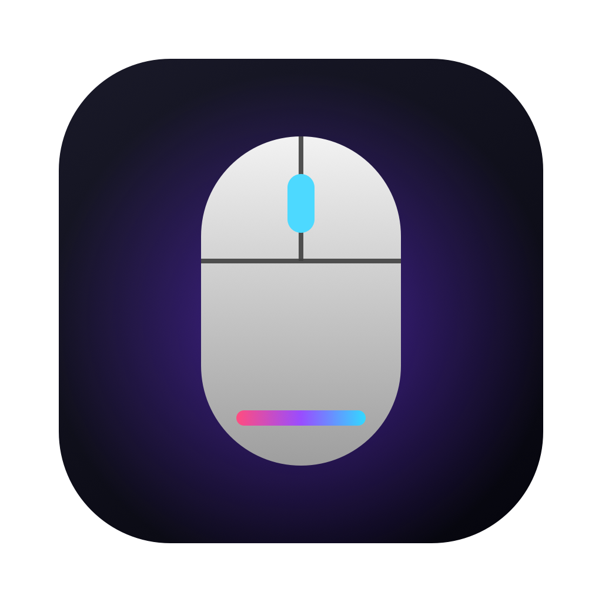
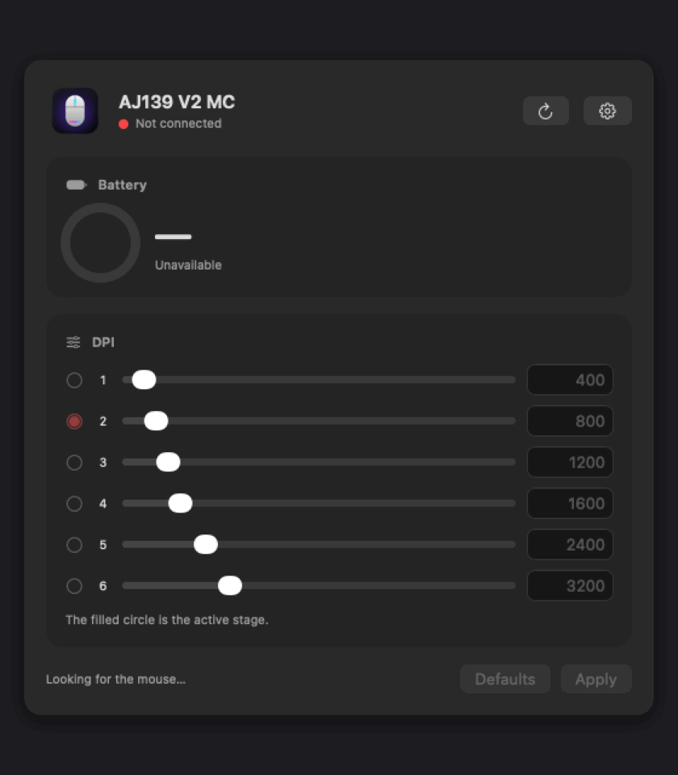

<p align="center">
  
</p>

<h1 align="center">AJ139 Driver</h1>

<p align="center">
  <strong>A free, open-source macOS app for the AJAZZ AJ139 V2 MC mouse.</strong><br>
  Battery level, DPI, button macros and smooth scrolling on your Mac, without booting Windows.
</p>

<p align="center">
  <a href="https://github.com/werquess/ajazz-aj139-macos/releases/latest/download/AJ139-Driver.dmg"></a>
  <a href="https://github.com/werquess/ajazz-aj139-macos/releases/latest/download/AJ139-Driver.zip"></a>
  <a href="https://buymeacoffee.com/werquess"></a>
</p>

<p align="center">
  
  
  
  
</p>

<p align="center">
  
</p>

---

## Why AJ139 Driver?

The AJ139 V2 MC is a great mouse, but its configuration software only runs on Windows. On a Mac you are stuck with whatever DPI was set at the factory and no way to see the battery level.

AJ139 Driver talks to the mouse directly over its own HID protocol, which was worked out from the official Windows software and tested on a real device.

- **Free and open source.** MIT licensed. No ads, no tracking, no accounts.
- **No drivers to install.** No kernel extensions and no system extensions. It uses the standard macOS HID APIs.
- **Native and small.** Written in Swift and SwiftUI. About 1 MB.
- **Settings live on the mouse.** Everything you change is stored in the mouse itself, so it keeps working on other computers too.

## Features

### 🔋 Battery
- Battery level as a percentage with a ring indicator.
- Shows when the mouse is on USB power.
- Refreshes automatically every 15, 30, 60 or 300 seconds.

### 🎯 DPI
- Six DPI stages, each adjustable from 50 to 26000 DPI with a slider or by typing the value.
- Pick which stage is active.
- The DPI button on the mouse cycles through the stages you set.
- One click to go back to the default stages.

### 🖱️ Buttons and macros
- Assign the middle button and both side buttons to Back, Forward, tab switching, Mission Control, Show Desktop, Spotlight, copy and paste, media keys and more.
- Record any keyboard shortcut for a button.
- Build macros from shortcuts, typed text and pauses and put them on a button.
- Works over USB, the 2.4 GHz receiver and Bluetooth. Left and right buttons are never touched.

### 🌀 Scrolling
- Smooth, accelerated scrolling for the mouse wheel.
- Reverse the wheel direction without changing the trackpad.
- Adjustable scroll speed and precise scrolling while holding Option.
- Trackpads and Magic Mouse are not affected.

### 📌 Menu bar
- Battery level in the menu bar.
- Switch DPI stages and toggle scrolling features from the menu.
- Keeps running in the background when the window is closed. The Dock icon is optional and it can open at login.

Buttons, macros and scrolling need Accessibility access. The app shows a button that opens the right page in System Settings. Starting with 1.1.1 the permission is kept across updates. If you are coming from an older version, remove AJ139 Driver from the Accessibility list with − once and add it again.

### 🌍 Languages
- English and Türkçe, or follow the system language.

## Installation

1. **[Download AJ139-Driver.dmg](https://github.com/werquess/ajazz-aj139-macos/releases/latest/download/AJ139-Driver.dmg)**
2. Open the disk image and drag **AJ139 Driver** into **Applications**.
3. Connect the mouse with the USB cable or the 2.4 GHz receiver and open AJ139 Driver. Bluetooth is not enough, see [Supported devices](#supported-devices).

Prefer a plain archive? Use **[AJ139-Driver.zip](https://github.com/werquess/ajazz-aj139-macos/releases/latest/download/AJ139-Driver.zip)** instead.

> [!NOTE]
> AJ139 Driver is not notarized by Apple yet. On first launch macOS may say it can't verify the developer.
> Right-click AJ139 Driver in Applications and choose **Open**, or go to **System Settings › Privacy & Security** and click **Open Anyway**. You only need to do this once.

### Requirements
- macOS 14 Sonoma or later
- A Mac with Apple Silicon
- AJAZZ AJ139 V2 MC connected over USB or the 2.4 GHz receiver

### Supported devices

| Device | Connection | Status |
| --- | --- | --- |
| AJAZZ AJ139 V2 MC | USB cable | Tested |
| AJAZZ AJ139 V2 MC | 2.4 GHz receiver | Should work, not tested yet |
| AJAZZ AJ139 V2 MC | Bluetooth | Buttons, macros and scrolling work. Battery and DPI are not available |

Over Bluetooth the mouse only exposes the standard mouse and keyboard reports. It does not share its battery level or settings, not even with macOS itself. DPI stages you set over the cable are stored on the mouse and stay active over Bluetooth.

The mouse accepts DPI indicator colors but does not store them, so there is no color setting.

## Privacy

AJ139 Driver has no analytics, no telemetry and makes no network connections. It only talks to the mouse.

## Roadmap

- [ ] Polling rate setting
- [x] Button remapping and macros
- [x] Menu bar mode with battery level
- [x] Smooth and reversed scrolling
- [ ] Support for other AJAZZ mice that use the same chip

Have an idea or another AJAZZ mouse you want supported? [Open an issue](https://github.com/werquess/ajazz-aj139-macos/issues).

## Building from source

```bash
git clone https://github.com/werquess/ajazz-aj139-macos.git
cd ajazz-aj139-macos
scripts/build_app.sh
```

This builds `build/AJ139 Driver.app`. Only the Xcode Command Line Tools are needed.

The protocol is documented in [PROTOCOL.md](PROTOCOL.md).

### Publishing a release

```bash
scripts/release.sh 1.1.0
gh release create v1.1.0 dist/AJ139-Driver.dmg dist/AJ139-Driver.zip --title "AJ139 Driver 1.1.0" --notes-file CHANGELOG.md
```

Both files need to be attached to every release so the download buttons above keep working.

## Support AJ139 Driver

AJ139 Driver is free and always will be. If it saved you from booting Windows, you can support its development:

<a href="https://buymeacoffee.com/werquess"></a>

Starring the repo and telling a friend helps a lot too. ⭐

## Contributing

Bug reports, translations and pull requests are welcome.

## License

AJ139 Driver is released under the [MIT License](LICENSE).

AJAZZ is a trademark of its respective owner. This project is not affiliated with or endorsed by AJAZZ.
